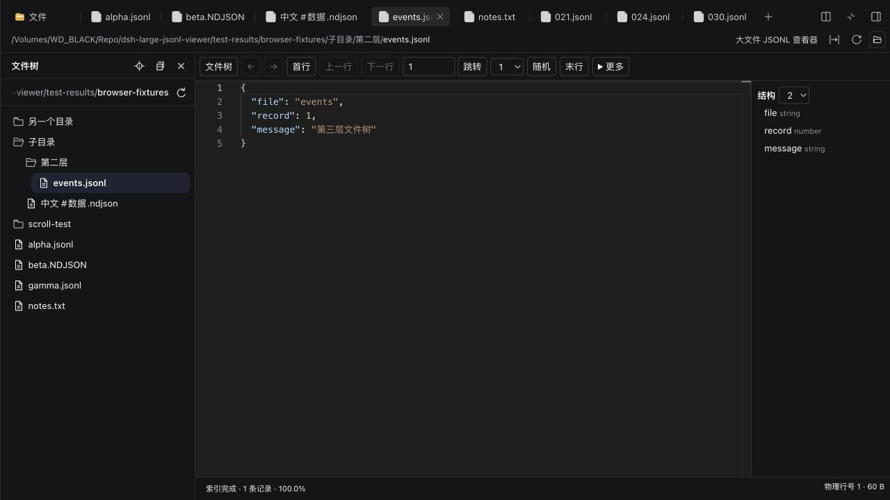

<div align="center">
  
  <h1>Large JSONL Viewer</h1>
  <p><b>Large files. One record at a time.</b></p>
  <p>A read-only JSONL &amp; NDJSON viewer inside DeepSeek Harness.</p>
  <a href="https://www.npmjs.com/package/dsh-large-jsonl-viewer"></a>
  <a href="./docs/validation.md"></a>
  <a href="https://github.com/liaojianjin/dsh-large-jsonl-viewer/releases"></a>
  <a href="./docs/compatibility.md"></a>
  <a href="./LICENSE"></a>
  <p><b>English</b> · <a href="./README_ZH.md">简体中文</a></p>
  <p><a href="#-features">Features</a> · <a href="#-installation">Install</a> · <a href="#-measured-performance">Benchmarks</a> · <a href="#-faq">FAQ</a></p>
</div>

Browse records by physical line, preserve the original JSON, and inspect oversized records through paged structure and text windows. Files stay in the Host filesystem; this plugin makes **no model calls** and adds **no file contents to chat context**.

<p align="center">
  
  <br /><sub>Actual Harness UI · physical-line navigation · lossless formatting · structure navigation</sub>
</p>

## ✨ Features

| | |
| --- | --- |
| **🧭 Jump to any record**<br/>First/previous/next/last, physical-line jumps, random sampling and back/forward history. The initial selector exposes the first 100 indexed lines. | **🧾 Keep JSON faithful**<br/>Formatting preserves number lexemes, duplicate keys, key order and escapes. Large integers remain exact text. |
| **🌲 Navigate the structure**<br/>Read-only Monaco, folding, expansion depth, key navigation, current-record find, word wrap and focus mode. | **🌊 Inspect oversized records**<br/>Above the ordinary-record budget, switch to paged structure and bounded 64 KiB text windows. |
| **🧩 Open from the file panel**<br/>Native document preview for `.jsonl` / `.ndjson`, with an optional native file route for Better Sidebar 0.28.0. | **💾 Export original bytes**<br/>Keep the record and its original line separator. Stream to a native save picker when available; Blob fallback is capped at 16 MiB. |
| **🗂️ Working directory file tree**<br/>Open “File tree” to browse folders and files from the current session's working directory, including in fullscreen. | **↔️ Keep your place**<br/>Switch files without losing record position, expanded folders or tree scrolling; use “Reveal current file” when needed. |

<p align="center">
  
  <br /><sub>0.1.3 · Working directory file tree · Retained expansion and scrolling</sub>
</p>

### Inside Desktop

| Ordinary records | Oversized records |
| --- | --- |
|  |  |
| Exact `9007199254740993`, duplicate keys and navigation history. | A 32 MiB record, paged structure and the `[1,2,3]` byte window. |

Screenshots use generated test data. [Full Desktop validation →](./docs/validation.md)

## 🚀 Installation

**Targets: DeepSeek Harness 0.2.1-rc.2 / 0.2.1-rc.3.** Verified on macOS arm64; see the [validation report](./docs/validation.md) for the exact Web, official Desktop, Better Sidebar 0.28.0 and rc.3 coverage. Other Harness versions are not yet claimed compatible.

### Desktop

Open **Plugins → Add plugin**, enter the package name, install, then choose **Enable now**:

```text
dsh-large-jsonl-viewer
```

Open a `.jsonl` or `.ndjson` file from the file panel. If Better Sidebar is enabled, JSONL files use this viewer and other files keep their existing editor. Reopen file tabs that were already open before installation.

### Web / CLI

Install into an existing Web profile, then start or restart that profile:

```sh
dsh plugin --profile web add dsh-large-jsonl-viewer
dsh web
```

Desktop has its own plugin installation tree. A system CLI's `web` profile is not necessarily the Desktop profile.

<details>
<summary><b>Prebuilt Release archive &amp; updating</b></summary>

Download the archive and SHA-256 checksums from [v0.1.3](https://github.com/liaojianjin/dsh-large-jsonl-viewer/releases/tag/v0.1.3), or paste its fixed URL into Desktop's Add plugin dialog:

```text
https://github.com/liaojianjin/dsh-large-jsonl-viewer/releases/download/v0.1.3/dsh-large-jsonl-viewer-0.1.3.tgz
```

To replace an installed version in Desktop, uninstall this plugin from its detail page, then install and enable the new version. CLI installation/removal requires restarting the corresponding profile. The repository root is a private development workspace; use the prebuilt package for installation.

</details>

## ⌨️ Everyday controls

| Action | Control |
| --- | --- |
| Working directory tree | Click **File tree** to show / hide it; expand folders on demand; **Reveal current file** scrolls to the selection |
| Browse records | Physical-line input, first/last, previous/next, random |
| Switch records | `Alt+↑` / `Alt+↓` |
| Browse history | `Alt+←` / `Alt+→` |
| Inspect the current record | More → raw/formatted, folding, find, copy, export |
| Inspect oversized records | Open a structure node → View bytes |
| Source file changed | Choose **Rebuild index** before continuing |

Shortcuts respond only while the viewer is focused. Random sampling uses the indexed range. Pausing/cancelling an index affects other views of that file in the same Session; cancelling a pending line jump affects only the current view.

## 📊 Measured performance

Backend measurements on macOS arm64 · Apple M5 Pro · 64 GiB · Node 26.7 · local SSD. OS caches were not evicted.

| Fixture | Index session¹ | First record boundary | Random read/parse p95 | Host + workers peak RSS |
| --- | --- | --- | --- | --- |
| ~1 GiB · 100 KiB/record | 413 ms | 33 ms | 33.6 ms | 280.4 MiB |
| ~10 GiB · 100 KiB/record | 3894 ms | 33 ms | 31.4 ms | 286.0 MiB |

¹ Includes index completion, closing and checkpoint commit. These are warm/uncontrolled-cache **backend** results, excluding browser RPC and Monaco rendering; total RSS includes the runtime, not just the plugin's incremental memory. They are not end-to-end UI latency guarantees.

32/256 MiB single-record scans and 1,000 backend record switches were also measured. [Methodology, raw reports and limits →](./docs/validation.md)

## ⚙️ Configuration & limits

Defaults suit stable, uncompressed UTF-8 regular files. The source may be an object, array or scalar; blank lines still count as physical lines. Final-path symlinks, directories, devices and unknown-size sources are refused.

<details>
<summary><b>Host configuration</b></summary>

Override the plugin row in the profile's `cordis.patch.yml` using a complete configuration object:

```yaml
- id: large-jsonl-viewer
  config:
    cacheDirectory: /absolute/path/to/jsonl-cache
    scanChunkMiB: 4
    recordLimitMiB: 8
    cacheLimitMiB: 512
    maxLines: 10000000
    maxFiles: 2
    maxViews: 32
    maxRecordTasks: 2
    pollMs: 2000
```

Scan chunks accept 1/4/8 MiB; the ordinary-record budget accepts 1–16 MiB. The default formatting budget is 16 MiB, 100,000 nodes, 128 levels and about 2 seconds; exceeding it switches to streaming mode. Streaming metadata is capped at 2,000 nodes and the parser stack at 2,048 levels. Later pages of long containers may require another scan.

</details>

<details>
<summary><b>Cache, filesystem and export boundaries</b></summary>

- Host cache defaults to `~/.cache/dsh-large-jsonl-viewer`. It stores byte indexes, versions and fingerprints, not record contents. An unwritable directory or writer-lock conflict falls back to temporary storage; temporary indexes are removed on close. Stale crash locks are not forcibly reclaimed.
- Inactive caches use LRU eviction. Active indexes have explicit line and concurrency limits. Dense short-line files may reach the default 10-million-line cap; this is not a promise of unrestricted 100 GB support.
- A browser connected to a remote Host reads that Host's filesystem. Stable source files are required; version checks are not transactional snapshots.
- File System Access saves in chunks where supported. Other carriers use a Blob download capped at **16 MiB**. Clipboard copying is limited to ordinary, valid UTF-8 records.
- Preferences and history last until the tab closes. Record text is not stored in the persistent layout.

</details>

**Scope:** read-only viewing. Editing, automatic tailing, compressed files, whole-file search and cross-record JSONPath are not implemented. Windows/Linux, SSH, 50/100 GB, cold-cache performance, full browser p95 and long-run browser memory remain unverified. [Compatibility notes →](./docs/compatibility.md)

## ❓ FAQ

| Question | Answer |
| --- | --- |
| Better Sidebar still shows its own JSONL cards? | Open the file again from its file tree. Tabs opened before installing retain their original viewer. |
| The source changed? | Old content stops displaying. Explicitly rebuild the index to continue. |
| A record is too large for Monaco? | Use the paged structure and text windows. The plugin enforces its configured record budgets. |
| Can it edit or send records to a model? | It is read-only and makes no model calls. It does not add file contents to chat context. |

## 🛠️ Development

```sh
pnpm install --frozen-lockfile
pnpm build
pnpm typecheck
pnpm test
pnpm test:integration
pnpm pack:plugin
pnpm test:packaging
```

Builds compile Host and Client separately, generate strict Typert protocols, and include Monaco, workers, fonts, CSS and licenses. No CDN or separate plugin server is needed. The pinned Typert analyzer needs a build-only declaration inventory; [build notes](./docs/compatibility.md) explain it.

[Changelog](./docs/changelog.md) · [Validation](./docs/validation.md) · [Issues](https://github.com/liaojianjin/dsh-large-jsonl-viewer/issues) · [Catalog submission](./docs/distribution.md)

An additional scoped distribution is published through [GitHub Packages Actions](./docs/github-packages.md); the npmjs.org package and install command above retain their original identity.

## 📄 License & acknowledgements

MIT. The implementation adapts code from [VS Code Large JSONL Viewer](https://github.com/liaojianjin/vscode-large-jsonl-viewer), reference commit `9c90a87433b82ab615094a39d0ef1c17dadbc5b7`, and uses Harness APIs from reference commit `687f282e8625c6b8d11ff58211a90524be2e4317`. See [LICENSE](./LICENSE) and the package's third-party notices.
