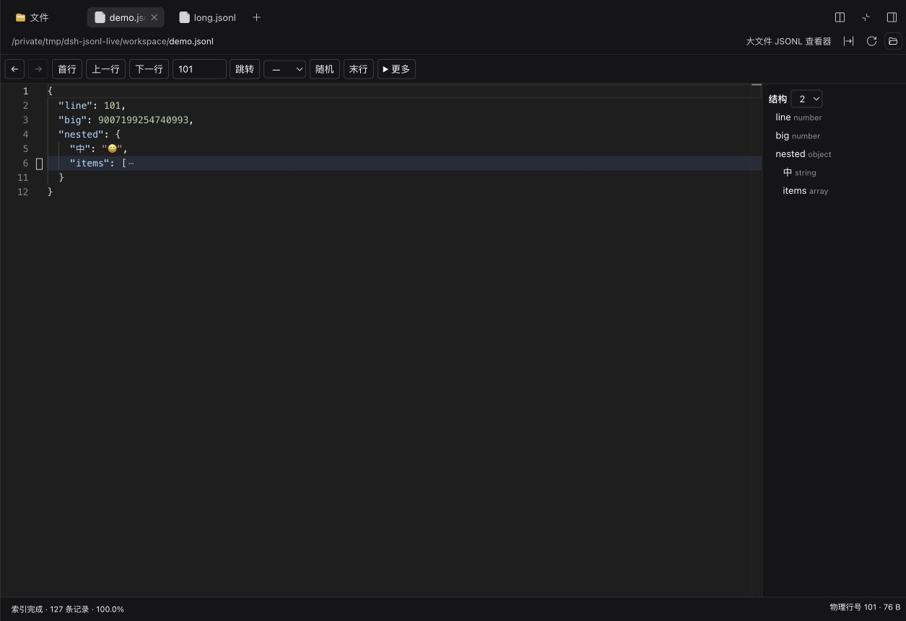
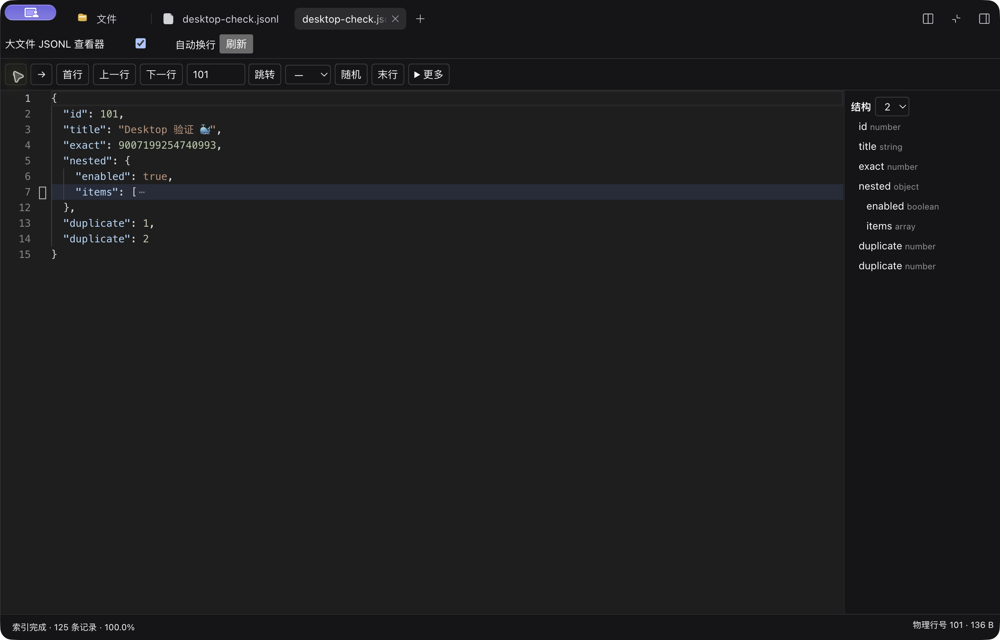
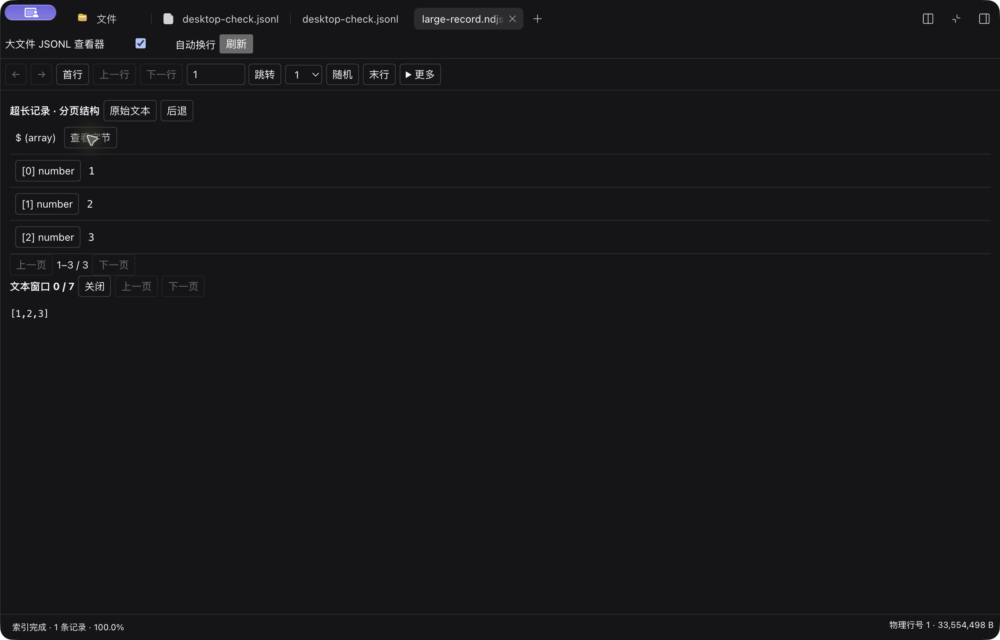

<div align="center">
  
  <h1>Large JSONL Viewer</h1>
  <p><b>大文件，逐条看。</b></p>
  <p>在 DeepSeek Harness 中只读浏览 JSONL 与 NDJSON。</p>
  <a href="https://www.npmjs.com/package/dsh-large-jsonl-viewer"></a>
  <a href="./docs/validation.md"></a>
  <a href="https://github.com/liaojianjin/dsh-large-jsonl-viewer/releases"></a>
  <a href="./docs/compatibility.md"></a>
  <a href="./LICENSE"></a>
  <p><a href="./README.md">English</a> · <b>简体中文</b></p>
  <p><a href="#-功能一览">功能</a> · <a href="#-安装">安装</a> · <a href="#-实测性能">性能</a> · <a href="#-常见问题">常见问题</a></p>
</div>

按物理行定位记录，保留原始 JSON 字面量，通过分页结构与文本窗口查看超长记录。文件从 Host 文件系统读取；插件**不调用模型**，也**不把文件内容写入聊天上下文**。

<p align="center">
  
  <br /><sub>真实 Harness 界面 · 物理行跳转 · 保真格式化 · 结构导航</sub>
</p>

## ✨ 功能一览

| | |
| --- | --- |
| **🧭 定位任意记录**<br/>首行、上一行、下一行、末行、物理行跳转、随机抽样与前后历史。初始选择器展示前 100 条已索引记录。 | **🧾 保留 JSON 原貌**<br/>格式化保留数字字面量、重复 key、key 顺序与转义。大整数按精确文本展示。 |
| **🌲 看清数据结构**<br/>只读 Monaco、折叠与展开层级、key 导航、本条查找、自动换行和专注模式。 | **🌊 查看超长记录**<br/>超过普通记录预算后，切换为分页结构和有界的 64 KiB 原文窗口。 |
| **🧩 从文件面板直接打开**<br/>原生预览支持 `.jsonl` / `.ndjson`；启用 Better Sidebar 0.28.0 时使用专用原生文件路由。 | **💾 导出原始字节**<br/>保留记录与原有行分隔符。可用时通过原生保存对话框分块写入；Blob 回退上限为 16 MiB。 |

### Desktop 实际效果

| 普通记录 | 超长记录 |
| --- | --- |
|  |  |
| 精确的 `9007199254740993`、重复 key 与导航历史。 | 32 MiB 单条记录、分页结构与 `[1,2,3]` 字节窗口。 |

截图均使用生成的测试数据。[查看完整 Desktop 验收记录 →](./docs/validation.md)

## 🚀 安装

**目标版本：DeepSeek Harness 0.2.1-rc.2。** 已在 macOS arm64 的 Web、官方 Desktop 和 Better Sidebar 0.28.0 中验证，其他 Harness 版本暂未声明兼容。

### Desktop

打开 **插件 → 添加插件**，输入包名，安装后点击 **立即启用**：

```text
dsh-large-jsonl-viewer
```

随后从文件面板打开 `.jsonl` 或 `.ndjson`。启用 Better Sidebar 时，JSONL 进入本查看器，其他文件仍使用原编辑器。安装前已打开的文件标签需要从文件树重新打开。

### Web / CLI

向已有 Web profile 安装，再启动或重启对应 profile：

```sh
dsh plugin --profile web add dsh-large-jsonl-viewer
dsh web
```

Desktop 有自己的插件安装树，不能假定系统 CLI 的 `web` profile 就是 Desktop profile。

<details>
<summary><b>预编译 Release 安装包与更新</b></summary>

从 [v0.1.2](https://github.com/liaojianjin/dsh-large-jsonl-viewer/releases/tag/v0.1.2) 下载 tgz 与 SHA-256 校验文件，或把固定版本地址粘贴到 Desktop 的添加插件对话框：

```text
https://github.com/liaojianjin/dsh-large-jsonl-viewer/releases/download/v0.1.2/dsh-large-jsonl-viewer-0.1.2.tgz
```

Desktop 替换已安装版本时，先在该插件详情中卸载，再安装并启用新版。CLI 安装或卸载后需重启对应 profile。仓库根目录是 private 开发工作区，安装应使用预编译包。

</details>

## ⌨️ 日常操作

| 操作 | 控件或快捷键 |
| --- | --- |
| 浏览记录 | 物理行输入框、首行/末行、上一行/下一行、随机 |
| 切换记录 | `Alt+↑` / `Alt+↓` |
| 浏览历史 | `Alt+←` / `Alt+→` |
| 查看当前记录 | 更多 → 原文/格式化、折叠、查找、复制、导出 |
| 查看超长记录 | 打开结构节点 → 查看字节 |
| 源文件变化 | 明确点击 **重建索引** 后继续 |

快捷键仅在查看器聚焦时响应。随机抽样使用已索引范围。暂停或取消索引会影响同一 Session 中该文件的其他视图；取消一次待完成的跳转只影响当前视图。

## 📊 实测性能

后端测试环境：macOS arm64 · Apple M5 Pro · 64 GiB · Node 26.7 · 本地 SSD。未驱逐 OS 缓存。

| 样本 | 索引会话¹ | 首条记录边界 | 随机读取/解析 p95 | Host + workers 峰值 RSS |
| --- | --- | --- | --- | --- |
| 约 1 GiB · 100 KiB/条 | 413 ms | 33 ms | 33.6 ms | 280.4 MiB |
| 约 10 GiB · 100 KiB/条 | 3894 ms | 33 ms | 31.4 ms | 286.0 MiB |

¹ 含索引完成、关闭与检查点提交。这些是暖缓存/未受控缓存下的**后端结果**，不包含浏览器 RPC 和 Monaco 绘制；总 RSS 包含运行环境，并非插件的增量内存，不能当作界面端到端延迟保证。

另已测量 32/256 MiB 单条扫描及 1,000 次后端切行。[测试方法、原始报告与限制 →](./docs/validation.md)

## ⚙️ 配置与边界

默认面向稳定、未压缩的 UTF-8 普通文件。JSON 根可以是对象、数组或标量；空白行仍占物理行号。最终路径 symlink、目录、设备和未知大小的文件会被拒绝。

<details>
<summary><b>Host 配置</b></summary>

在 profile 的 `cordis.patch.yml` 中，用完整配置对象覆盖插件行：

```yaml
- id: large-jsonl-viewer
  config:
    cacheDirectory: /absolute/path/to/jsonl-cache
    scanChunkMiB: 4
    recordLimitMiB: 8
    cacheLimitMiB: 512
    maxLines: 10000000
    maxFiles: 2
    maxViews: 32
    maxRecordTasks: 2
    pollMs: 2000
```

扫描块允许 1/4/8 MiB，普通记录预算允许 1–16 MiB。默认格式化上限为 16 MiB、100,000 节点、128 层和约 2 秒，超限转为流式模式。流式节点元数据最多 2,000 项、解析栈最多 2,048 层。超长容器的后部页面可能需要再次扫描。

</details>

<details>
<summary><b>缓存、文件系统与导出边界</b></summary>

- Host 缓存默认位于 `~/.cache/dsh-large-jsonl-viewer`，只包含字节索引、版本与指纹，不含记录正文。目录不可写或 writer 锁冲突时回退临时目录；临时索引关闭后删除，不会强行抢占崩溃残留锁。
- 非活动缓存使用 LRU 清理，活动索引有明确的行数与并发上限。密集短行文件可能先达到默认 1,000 万行上限，不能承诺任意 100 GB 文件都能打开。
- 浏览器连接远端 Host 时，读取的是该 Host 的文件系统。源文件需要稳定，版本检查不是事务性快照。
- 支持 File System Access 时分块保存；其他环境使用最多 **16 MiB** 的 Blob 下载。剪贴板复制仅支持普通、有效 UTF-8 记录。
- 偏好和历史保留到标签关闭，正文不进入持久布局。

</details>

**功能范围：只读浏览。** 暂不支持编辑、自动追尾、压缩文件、全文件搜索和跨记录 JSONPath。Windows/Linux、SSH、50/100 GB、冷缓存、完整浏览器 p95 与长期浏览器内存仍未验收。[兼容性说明 →](./docs/compatibility.md)

## ❓ 常见问题

| 问题 | 处理方式 |
| --- | --- |
| Better Sidebar 仍显示自己的 JSONL 卡片？ | 从文件树重新打开。安装前的标签会保留原来的查看器。 |
| 源文件发生变化？ | 旧正文会停止显示，需要明确重建索引后继续。 |
| 单条记录太大，无法用 Monaco 展示？ | 使用分页结构与文本窗口，插件会执行配置中的预算限制。 |
| 会编辑文件或发送给模型吗？ | 只读，不调用模型，也不把文件内容写入聊天上下文。 |

## 🛠️ 开发

```sh
pnpm install --frozen-lockfile
pnpm build
pnpm typecheck
pnpm test
pnpm test:integration
pnpm pack:plugin
pnpm test:packaging
```

构建分别编译 Host / Client、生成严格 Typert 协议，并携带 Monaco、worker、字体、CSS 和许可证，无需 CDN 或单独的插件服务器。当前 Typert 分析器需要仅用于构建的声明 inventory，详见 [构建说明](./docs/compatibility.md)。

[更新记录](./docs/changelog.md) · [验证报告](./docs/validation.md) · [问题反馈](https://github.com/liaojianjin/dsh-large-jsonl-viewer/issues) · [目录收录](./docs/distribution.md)

另提供通过 [GitHub Packages Actions](./docs/github-packages.md) 发布的 scoped 分发包；上方 npmjs.org 包名与安装命令保持不变。

## 📄 许可与致谢

MIT。实现改编自 [VS Code Large JSONL Viewer](https://github.com/liaojianjin/vscode-large-jsonl-viewer)，参考 commit `9c90a87433b82ab615094a39d0ef1c17dadbc5b7`；Harness 接口参考 commit `687f282e8625c6b8d11ff58211a90524be2e4317`。许可证见 [LICENSE](./LICENSE) 和发布包中的第三方声明。
